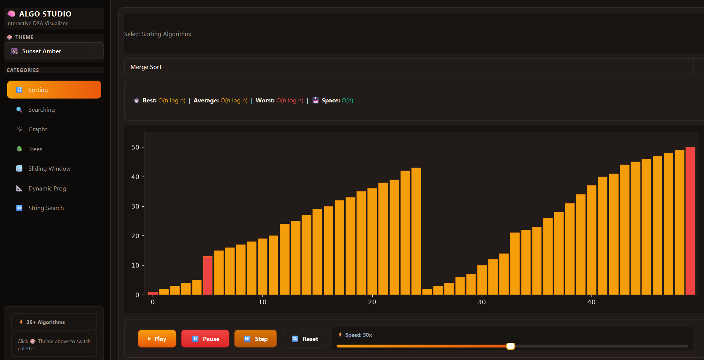
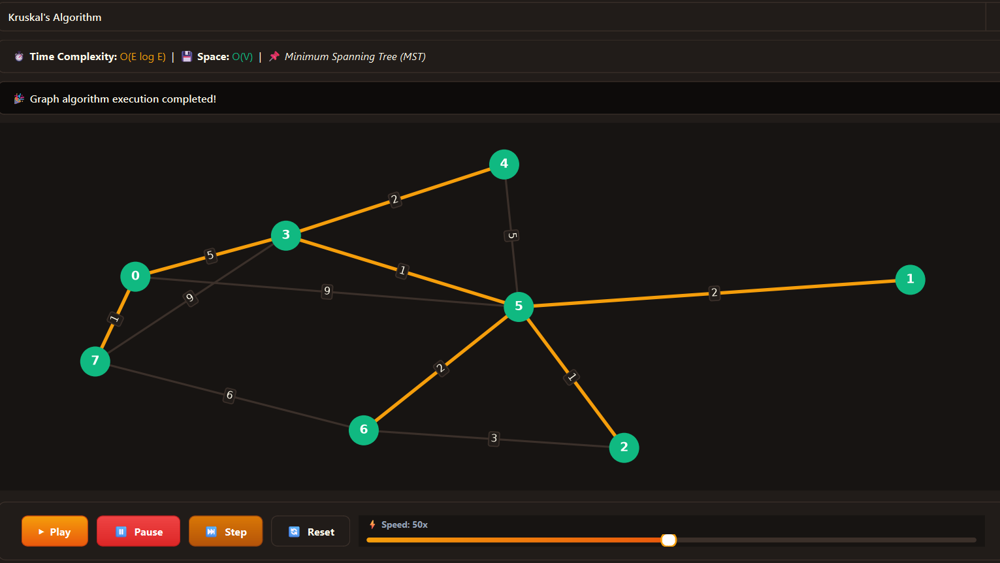

# 🧠 ALGO STUDIO — Interactive Algorithm Visualizer

An interactive desktop application built with **Python**, **PySide6 (Qt6)**, **Matplotlib**, and **NetworkX** to visualize and understand data structures and algorithms in real-time.

**Author:** [Kushal Patel](https://github.com/kushalpatel8)

---

## 📸 Screenshots

### 1. Sorting Visualizer (Merge Sort in *Sunset Amber* Theme)


### 2. Graph Visualizer (Kruskal's Minimum Spanning Tree Algorithm)


---

## ✨ Features

- **⚡ 38+ Algorithms Implemented:** Covers Sorting, Searching, Graphs, Trees, Dynamic Programming, Sliding Window, and String Searching.
- **⏯️ Full Playback Control:** Play, pause, step-by-step frame inspection, reset data, and real-time animation speed control (1x – 100x).
- **⏱️ Complexity Badges:** Instant reference for Best, Average, and Worst-case Time Complexities as well as Space Complexity.
- **🎨 Dynamic Multi-Theme Engine:** Seamlessly toggle between dark and light themes:
  - 🌲 **Emerald Studio** (Default dark green)
  - 🌇 **Sunset Amber** (Warm amber / dark)
  - 🔮 **Cyberpunk Violet** (Neon violet / dark)
  - 🟤 **Monokai Pro** (Developer-favorite code palette)
  - ❄️ **Nordic Light** (Crisp, clean high-contrast light theme)
- **📊 Adaptive Visualizations:** Powered by Matplotlib canvases seamlessly embedded into Qt with synchronized theme palettes.

---

## 📚 Supported Algorithms

### 1. 🔢 Sorting Algorithms
| Algorithm | Best | Average | Worst | Space |
| :--- | :---: | :---: | :---: | :---: |
| **Bubble Sort** | $O(n)$ | $O(n^2)$ | $O(n^2)$ | $O(1)$ |
| **Selection Sort** | $O(n^2)$ | $O(n^2)$ | $O(n^2)$ | $O(1)$ |
| **Insertion Sort** | $O(n)$ | $O(n^2)$ | $O(n^2)$ | $O(1)$ |
| **Quick Sort** | $O(n \log n)$ | $O(n \log n)$ | $O(n^2)$ | $O(\log n)$ |
| **Merge Sort** | $O(n \log n)$ | $O(n \log n)$ | $O(n \log n)$ | $O(n)$ |
| **Heap Sort** | $O(n \log n)$ | $O(n \log n)$ | $O(n \log n)$ | $O(1)$ |
| **Shell Sort** | $O(n \log n)$ | $O(n^{4/3})$ | $O(n^{3/2})$ | $O(1)$ |
| **Cocktail Shaker Sort** | $O(n)$ | $O(n^2)$ | $O(n^2)$ | $O(1)$ |
| **Comb Sort** | $O(n \log n)$ | $O(n^2)$ | $O(n^2)$ | $O(1)$ |
| **Tim Sort** | $O(n)$ | $O(n \log n)$ | $O(n \log n)$ | $O(n)$ |
| **Gnome Sort** | $O(n)$ | $O(n^2)$ | $O(n^2)$ | $O(1)$ |
| **Radix Sort** | $O(nk)$ | $O(nk)$ | $O(nk)$ | $O(n + k)$ |
| **Counting Sort** | $O(n + k)$ | $O(n + k)$ | $O(n + k)$ | $O(k)$ |

### 2. 🔍 Searching Algorithms
- **Linear Search** — Sequential search with highlighted scanning pointer.
- **Binary Search** — Logarithmic search on sorted arrays with low/mid/high range boundaries.
- **Jump Search** — Block jumping algorithm.
- **Ternary Search** — Divide-and-conquer search with double pivot points.
- **Exponential Search** — Range finding followed by binary search.

### 3. 🌐 Graph Algorithms
- **Breadth-First Search (BFS)** — Level-order graph traversal.
- **Depth-First Search (DFS)** — Backtracking exploration.
- **Dijkstra's Algorithm** — Single-source shortest path with weighted edges.
- **A* Search** — Heuristic-driven pathfinding.
- **Bellman-Ford Algorithm** — Shortest path handling negative edge weights.
- **Floyd-Warshall Algorithm** — All-pairs shortest paths.
- **Prim's Algorithm** — Greedy Minimum Spanning Tree (MST).
- **Kruskal's Algorithm** — Disjoint-set union Minimum Spanning Tree (MST).

### 4. 🌲 Tree Algorithms
- **Binary Search Tree (BST)** with dynamic tree layout and step-by-step traversals:
  - **Inorder Traversal** (Left, Root, Right)
  - **Preorder Traversal** (Root, Left, Right)
  - **Postorder Traversal** (Left, Right, Root)

### 5. 🧩 Dynamic Programming (DP)
- **Fibonacci Sequence** — Iterative memoization vs tabulation state progression.
- **0/1 Knapsack Problem** — 2D value-weight matrix construction.
- **Longest Common Subsequence (LCS)** — Table construction and optimal string reconstruction.
- **Coin Change Problem** — Fewest coins determination table.

### 6. 🪟 Sliding Window
- **Maximum Sum Subarray** — Fixed window size $K$ sliding across dynamic arrays.
- **Longest Substring with K Distinct Characters** — Variable window expansion and contraction.

### 7. 🔤 String Search Algorithms
- **KMP (Knuth-Morris-Pratt)** — Pattern matching utilizing LPS (Longest Prefix Suffix) table.
- **Rabin-Karp** — Rolling hash matching with collision checks.
- **Boyer-Moore** — Bad character rule with right-to-left character scanning.

---

## 🛠️ Tech Stack

- **GUI Framework:** [PySide6](https://pypi.org/project/PySide6/) (Qt6 for Python)
- **Plotting & Canvas:** [Matplotlib](https://matplotlib.org/) (integrated via `FigureCanvasQTAgg`)
- **Graph Modeling:** [NetworkX](https://networkx.org/)
- **Numerical Computations:** [NumPy](https://numpy.org/)
- **Color Palettes & Styling:** [Seaborn](https://seaborn.pydata.org/) & Custom QSS Design System

---

## 🚀 Getting Started

### Prerequisites

- Python 3.10+ (compatible with Python 3.11, 3.12, 3.13)
- Windows / macOS / Linux

### 1. Clone the Repository
```bash
git clone https://github.com/kushalpatel8/Algorithm-Visualizer.git
cd Algorithm-Visualizer
```

### 2. Set Up a Virtual Environment (Recommended)
```bash
# Windows
python -m venv .venv
.venv\Scripts\activate

# macOS / Linux
python3 -m venv .venv
source .venv/bin/activate
```

### 3. Install Dependencies
```bash
pip install -r requirements.txt
```

### 4. Run the Application
```bash
python main.py
```

---

## 🎮 How to Use

1. **Select Category:** Use the left sidebar to switch between algorithm categories (Sorting, Searching, Graphs, Trees, etc.).
2. **Choose Algorithm:** Select your desired algorithm from the dropdown at the top of the visualizer.
3. **Configure Inputs:** For searching or string algorithms, you can customize the target value or text pattern.
4. **Playback:**
   - **Play (▶):** Run the animation automatically.
   - **Pause (⏸):** Freeze animation at any point.
   - **Step (⏭):** Advance execution frame-by-frame.
   - **Reset (🔄):** Generate fresh random data or reset to default state.
   - **Speed Slider (⚡):** Adjust execution speed in real-time.
5. **Change Theme:** Use the theme dropdown in the sidebar to switch between *Emerald Studio*, *Sunset Amber*, *Cyberpunk Violet*, *Monokai Pro*, or *Nordic Light*.

---

## 📁 Project Architecture

```
Algorithm-Visualizer/
├── algorithms/                 # Pure algorithm implementations (Generators)
│   ├── dp/                     # Dynamic programming algorithms
│   ├── graph/                  # Graph traversal & pathfinding algorithms
│   ├── searching/              # Search algorithms
│   ├── slidingWindow/          # Sliding window algorithms
│   ├── sorting/                # 13 sorting algorithms
│   ├── string/                 # String matching algorithms
│   └── tree/                   # Tree data structures & traversals
├── ui/                         # PySide6 UI components & theming
│   ├── controls.py             # Play/Pause/Step/Reset & Speed controls
│   ├── main_window.py          # Main application window & sidebar
│   └── styles.py               # Theme engine & QSS stylesheets
├── visualizer/                 # Category visualizers (Matplotlib + Qt)
│   ├── dp_visualizer.py
│   ├── graph_visualizer.py
│   ├── searching_visualizer.py
│   ├── sliding_visualizer.py
│   ├── sorting_visualizer.py
│   ├── string_visualizer.py
│   └── tree_visualizer.py
├── Screenshot1.png             # UI preview (Merge Sort)
├── Screenshot2.png             # UI preview (Kruskal's Algorithm)
├── main.py                     # Application entry point
├── requirements.txt            # Python dependencies
└── README.md                   # Documentation & setup guide
```

---

## 👨‍💻 Author

**Kushal Patel**
- GitHub: [@kushalpatel8](https://github.com/kushalpatel8)

---

## 📄 License

This project is licensed under the MIT License. Feel free to use, modify, and distribute it for educational and personal projects.

